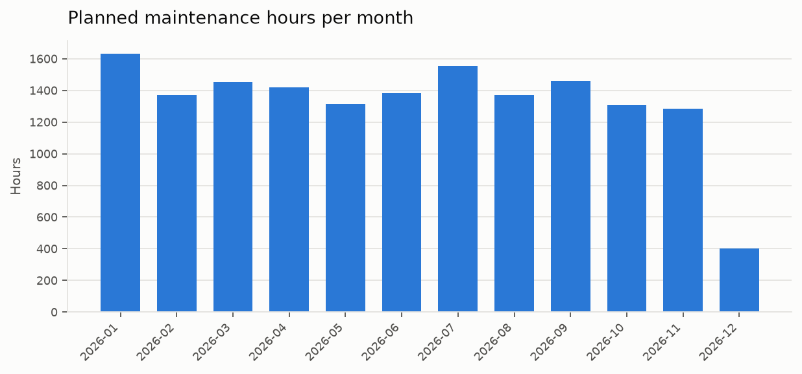
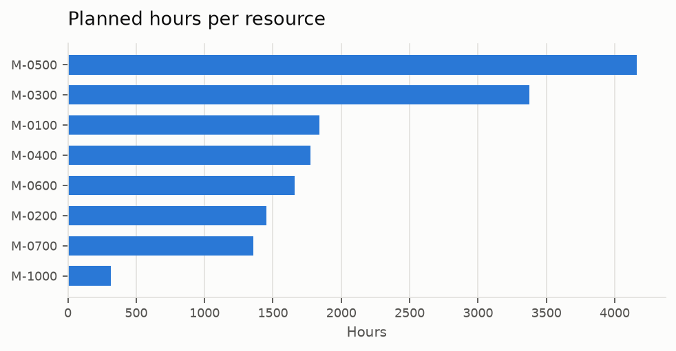
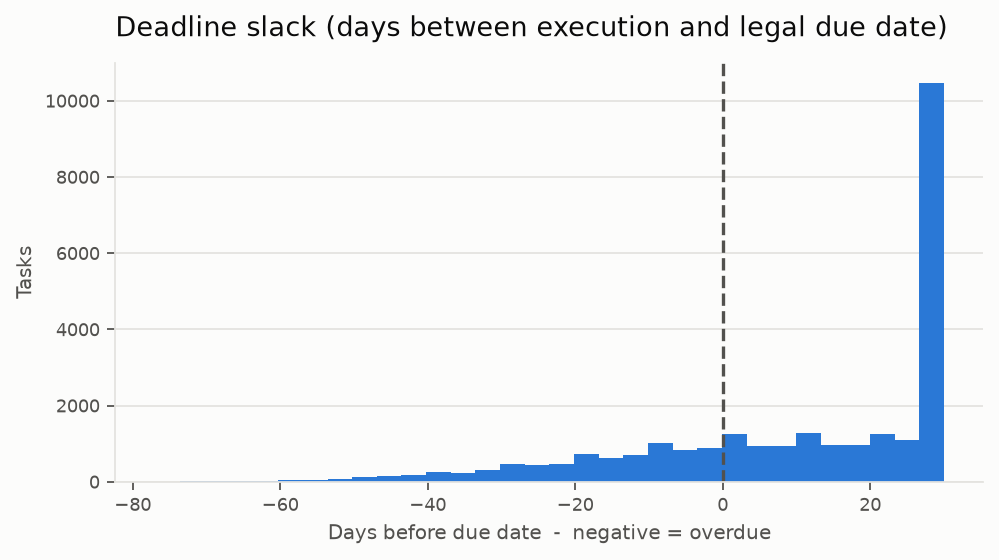

# Maintenance scheduling for a hospital medical-technology department

Turning a 69 000-row SAP export of legally mandated equipment inspections into
an executable, year-long work plan for 22 technicians - with the deadline
compliance, capacity utilisation and travel time of that plan measured, not
assumed.

Built for the medical-technology department of a German hospital, where the
annual plan was previously assembled by hand in Excel. This repository contains
the full pipeline; the hospital's data is replaced by a synthetic generator that
reproduces its schema and its data-quality problems, so everything here runs
end to end on a clean checkout.

```bash
pip install -r requirements.txt
pip install -e .                                   # src-layout: the package must be installed to be importable
python scripts/generate_synthetic_data.py          # creates data/raw/maintenance_export.xlsx
python -m maintenance_scheduler schedule --mode team
```

---

## Problem

Every medical device in a German hospital carries legally mandated recurring
inspections - safety checks (*sicherheitstechnische Kontrolle*), metrological
controls (*messtechnische Kontrolle*, MPBetreibV §14), radiation-protection
tests, calibrations. SAP PM generates a *maintenance call* for each device and
each due date, but SAP does not plan the work: it does not know who is on
holiday, how many hours a day a technician can actually spend on planned
maintenance, or that a route across the campus costs time that no one books.

So the department head planned by hand. That meant:

- one Excel sheet per team, rebuilt every planning period;
- no way to tell, before the year started, which deadlines were unreachable;
- work ordered by due date, so a technician crossed the campus several times a
  day;
- no quantitative answer to the only question management cares about - *do we
  have enough people?*

The goal was not "an optimal schedule". It was **a plan a team lead can print,
plus an honest, measurable statement of what the department can and cannot
deliver with its current headcount.**

## Data

| Source | Shape | Content |
|---|---|---|
| `Rohdaten` sheet | ~69 000 rows × 69 columns (45 000 rows in the synthetic copy) | one row per SAP maintenance call: device, maintenance plan, activity code, technician group, location, due date, nominal duration |
| `Zusatdaten` sheet | hand-maintained | teams and members, absences, working calendar, daily maintenance capacity per team, maximum permitted lead time, activity-code table |

The second sheet is the interesting one: it is where the planner's knowledge
lives, and it is maintained by hand in a single sheet with column blocks of
different lengths padded by blanks. The loader parses it block by block instead
of treating it as one table.

**Roughly 40 % of the export is not schedulable work**, and separating the two
is a precondition for the problem being solvable at all:

| Filter | Rows removed |
|---|---|
| status not actionable (simulated calls, deactivated equipment) | 12 105 |
| external service provider, or device never assigned to a team | 5 409 |
| missing due date / outside the planning horizon | 0 |
| **remaining schedulable tasks** | **27 486** |

Data-quality problems handled explicitly, because each one is a silent way to
produce a wrong plan:

- **18 % of durations are missing and 4 % are zero.** A zero duration would make
  a device look free to maintain. Both are replaced by the agreed minimum visit
  length (0.5 h) rather than dropped - a device with an unknown duration still
  has to be visited.
- **Durations marked `fremd`** are work done under an external contract. They
  stay in the plan for traceability but consume no internal capacity.
- **Locations are free text** (`"B12, 3. OG"` or just `"B12"`), typed by hand.
  They are parsed into `building|floor`: the building drives the batching, the
  floor is kept because technicians navigate by it.
- **Missing technician groups** are reported, not silently dropped - an
  unassigned device is a master-data defect the department wants to see.

Nothing is imputed by a model. Every replacement value is an explicit rule and
lives in `config/config.yaml`, so a planner can change it without touching code.

## Approach

The constraints are hard and the objective is soft, which rules out both a
plain sort and a full MILP model. A **constructive greedy scheduler with
explicit constraint checks** was chosen instead.

**Hard constraints** (a plan violating any of these is unusable):

1. a task is executed only by its own technician group - the groups map to
   device families (imaging, dialysis, laboratory, …) and to the
   qualifications the law requires;
2. only on calendar working days, excluding the person's absences;
3. within the daily *planned-maintenance* capacity - 4 h per technician in this
   department, the rest of the shift reserved for unplanned repairs, which are
   the work that cannot wait;
4. no earlier than `due_date − max_lead_days` (30), otherwise the maintenance
   interval drifts away from the manufacturer's specification and the next
   cycle shifts with it.

**Soft objective:** stay before the deadline, keep the load even across people
and months, and minimise walking between buildings.

The scheduler walks the tasks in a deliberate order and places each one on the
first day that satisfies every hard constraint. Two design decisions carry the
result.

### Decision 1

Sorting strictly by due date gives perfect deadline behaviour and a plan in
which a technician crosses the campus several times a day. Sorting by building
gives a walkable plan that misses deadlines by months.

The implementation treats deadlines as *equivalent inside a window* of
`batching_window_days`: within the window tasks are reordered by building
(busiest building first, so that whole days are filled in one place), across
windows the due-date order is preserved. Because the window is shorter than the
permitted lead time, batching never forces a task past its deadline by itself.

Measured trade-off (team mode, synthetic data, 27 486 tasks):

| window | building changes per day | on-time rate |
|---:|---:|---:|
| 1 day (pure due-date order) | 9.84 | 74.8 % |
| 7 days | 4.67 | 74.0 % |
| 14 days | 3.76 | 72.9 % |
| **30 days (default)** | **3.48** | **71.5 %** |
| 60 days | 3.87 | 72.8 % |

**A 30-day window removes about two thirds of the daily building changes for
roughly three percentage points of on-time rate.** In technician mode the same
setting takes building changes from 4.07 to 1.75 per day. 

### Decision 2

The first implementation assigned every task to a **named technician**. That is
the precise plan, and it is also the brittle one: a single unplanned absence
invalidates a named plan for weeks, and it removes the team lead's freedom to
swap people on the day.

So a second scheduler plans at **team level**. For each working day it computes
`capacity(day) = technicians present × daily hours` and fills that pool with the
same ordering, leaving the assignment of people to the team lead. Both
schedulers sit behind one interface, so the two policies can be run on identical
data and compared instead of argued about:

| | technician mode | team mode |
|---|---:|---:|
| tasks scheduled | 26 763 / 27 486 | 26 778 / 27 486 |
| coverage | 97.4 % | 97.4 % |
| on-time rate | 71.3 % | 71.5 % |
| on-time rate, metrological controls | 71.6 % | 71.8 % |
| capacity utilisation | 79.3 % | 79.4 % |
| building changes per resource-day | 1.75 | 3.48 |

Team mode loses nothing on compliance and is the more robust plan operationally;
technician mode produces the tighter routes, because one person's day is one
route. Team mode is the default here, with technician mode kept as the "what
would a perfectly stable roster look like" reference.

Within a team, the technician scheduler assigns each task to whoever can start
it soonest, ties broken by the smallest workload so far. Plain round-robin was
the first attempt and it distributes badly as soon as absences differ between
people - a regression test now pins the balance.

## Evaluation

There is no ground-truth optimal plan to compare against, so the plan is scored
on what the department is actually judged on:

| Metric | What it answers |
|---|---|
| **on-time rate**, overall and for metrological controls alone | would this plan survive an audit? PMK is reported separately because it is what the regulator checks first |
| **coverage** | what share of the work fits in the year at all - the leftovers *are* the capacity gap |
| **capacity utilisation** | booked vs. available hours; ≈100 % means no room left for unplanned repairs |
| **building changes per resource-day** | proxy for walking time - the metric batching exists to improve |
| **load per resource and per month** | is the plan fair, and does it build a peak nobody can absorb? |

Hard constraints are covered by a property-style test suite
(`pytest`, 26 tests): no plan may exceed daily capacity, use a non-working day,
schedule an absent technician, breach the lead-time limit, assign a task outside
its group, or lose a task - every task is either scheduled exactly once or
reported as unscheduled.





## Results

On the synthetic data set (27 486 schedulable tasks, 8 teams, 22 technicians,
256 working days), team mode produces a full-year plan in a few seconds with
97.4 % coverage and 79.4 % capacity utilisation.

The more useful result is what the plan *fails* to do, because it localises the
problem:

| team | tasks | on-time rate |
|---|---:|---:|
| M-0700 | 2 290 | 97.9 % |
| M-1000 | 516 | 98.8 % |
| M-0300 | 5 680 | 96.1 % |
| M-0200 | 2 443 | 94.8 % |
| M-0500 | 7 001 | 83.5 % |
| M-0600 | 2 766 | 69.8 % |
| M-0100 | 3 130 | 13.6 % |
| M-0400 | 2 952 | 14.3 % |

Six teams are comfortable. Two are structurally under-staffed - they carry ~22 %
of the workload with ~18 % of the headcount and ~700 tasks that do not fit in
the year at all. A plan that reports "M-0100 and M-0400 cannot meet their legal
deadlines with two technicians each" is far more actionable than a plan that
silently pushes those tasks into next year, which is what a manual plan does.

*The figures above come from the synthetic generator in this repository. The
hospital's own results are confidential and are deliberately not reproduced
here.*

## Business impact

- **The annual plan becomes reproducible.** A re-plan after a resignation, a
  long-term absence or a new SAP export is a re-run with a changed input sheet,
  instead of rebuilding the sheets by hand.
- **Compliance risk becomes visible before the year starts**, per team and per
  activity type, instead of surfacing as an overdue inspection during an audit.
- **Travel time drops by roughly two thirds of the daily building changes** at a
  known, explicitly chosen cost in deadline slack.
- **The deliverable meets its users where they are:** Excel, one sheet per team,
  German headers, overdue lines and metrological controls colour-coded.

## Repository

```
config/config.yaml                 every business rule: filters, capacities, lead time, window
src/maintenance_scheduler/
├── config.py                      typed access to the YAML
├── domain.py                      Task, Team, Absence, PlanningContext, Schedule
├── data/loader.py                 SAP export + hand-maintained reference sheet
├── data/preprocessing.py          filters, duration rules, location parsing (counted)
├── scheduling/ordering.py         rolling due-date windows + building batching
├── scheduling/technician.py       per-person plan, least-loaded-first balancing
├── scheduling/team.py             pooled team capacity (the default policy)
├── metrics.py                     compliance, coverage, utilisation, travel
├── reporting/excel.py             colour-coded workbooks, one sheet per resource
├── reporting/plots.py             the three review charts
├── pipeline.py                    end-to-end run + policy comparison
└── cli.py                         python -m maintenance_scheduler
scripts/generate_synthetic_data.py synthetic workbook with the real schema
notebooks/01_demo.ipynb            executed walkthrough of a full run
tests/                             constraint and preprocessing tests
```

### Usage

```bash
pip install -r requirements.txt && pip install -e .
python scripts/generate_synthetic_data.py --rows 45000 --seed 42
python -m maintenance_scheduler schedule --mode team        # plan + Excel + metrics + charts
python -m maintenance_scheduler schedule --mode technician  # named-owner variant
python -m maintenance_scheduler compare                     # both policies, side by side
pytest
```

The package uses a `src/` layout, so `pip install -e .` is what makes
`maintenance_scheduler` importable - without it, `python -m maintenance_scheduler`
fails with `No module named maintenance_scheduler`. On Windows, call the
interpreter inside the virtual environment explicitly:

```powershell
py -m venv .venv
.\.venv\Scripts\python.exe -m pip install -r requirements.txt
.\.venv\Scripts\python.exe -m pip install -e .
.\.venv\Scripts\python.exe scripts\generate_synthetic_data.py
.\.venv\Scripts\python.exe -m maintenance_scheduler schedule --mode team
```

Outputs land in `data/processed/`:

| File | Content |
|---|---|
| `work_distribution.xlsx` | the plan - one sheet per team or technician |
| `unscheduled_tasks.xlsx` | the capacity gap, for the department head |
| `external_provider.xlsx` | external-contract orders, one sheet per month |
| `metrics.json` | all metrics plus the cleaning report of the run |

### Data and confidentiality

The repository contains **no hospital data**. `scripts/generate_synthetic_data.py`
generates a workbook with the same two sheets, the same column names and the
same distributions of statuses, groups, activity codes and data-quality defects,
using invented devices, buildings and staff. All figures quoted in this README
were produced by that generator with `--seed 42`.

